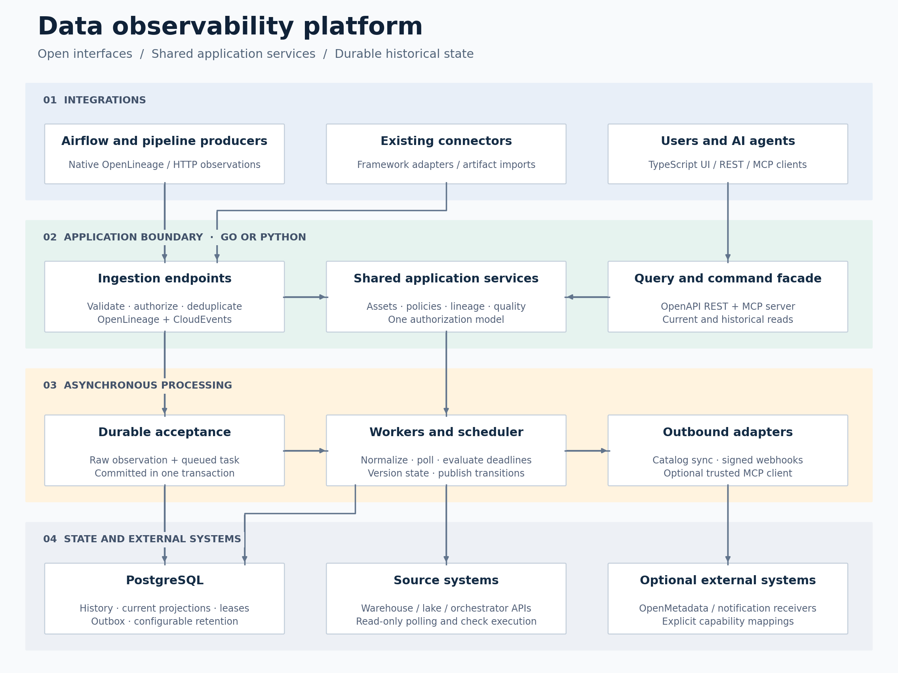

# Observability-platform

Data observability platform.

- [Detailed architecture design](data_observability_design.md)
- [Cloud-native security design](security_design.md)
- [Architecture diagram (SVG)](architecture.svg)
- [Architecture diagram (PNG)](architecture.png)

## Release 1 proposal

- [Detailed release design](release1_design.md)
- [Editable diagrams.net file](release1_architecture.drawio)
- [Offline browser viewer](release1_viewer.html) — download and open locally
- [Logical architecture](release1_architecture.svg)
- [Availability and recovery](release1_availability.svg)

Open the `.drawio` file in https://app.diagrams.net/ to edit both pages. Regenerate the SVGs and HTML with `python3 build_diagrams.py` (Python standard library only). These documents describe proposed behavior; application implementation has not started.
