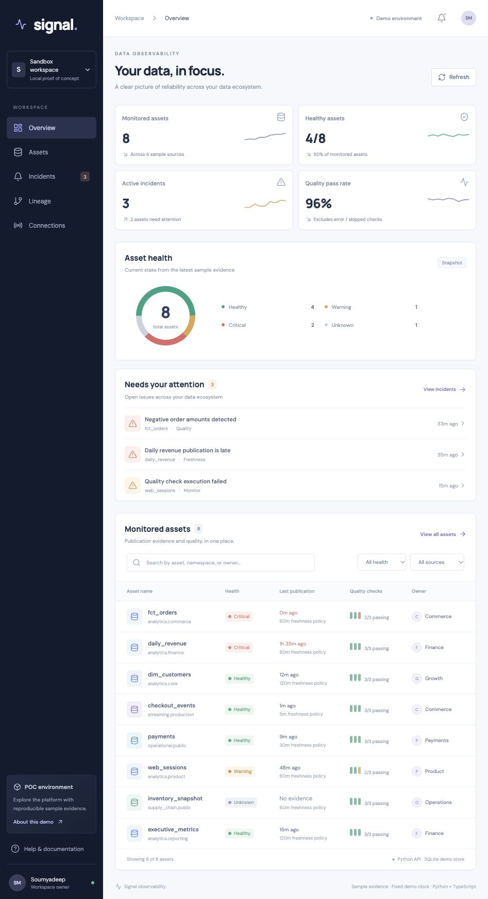
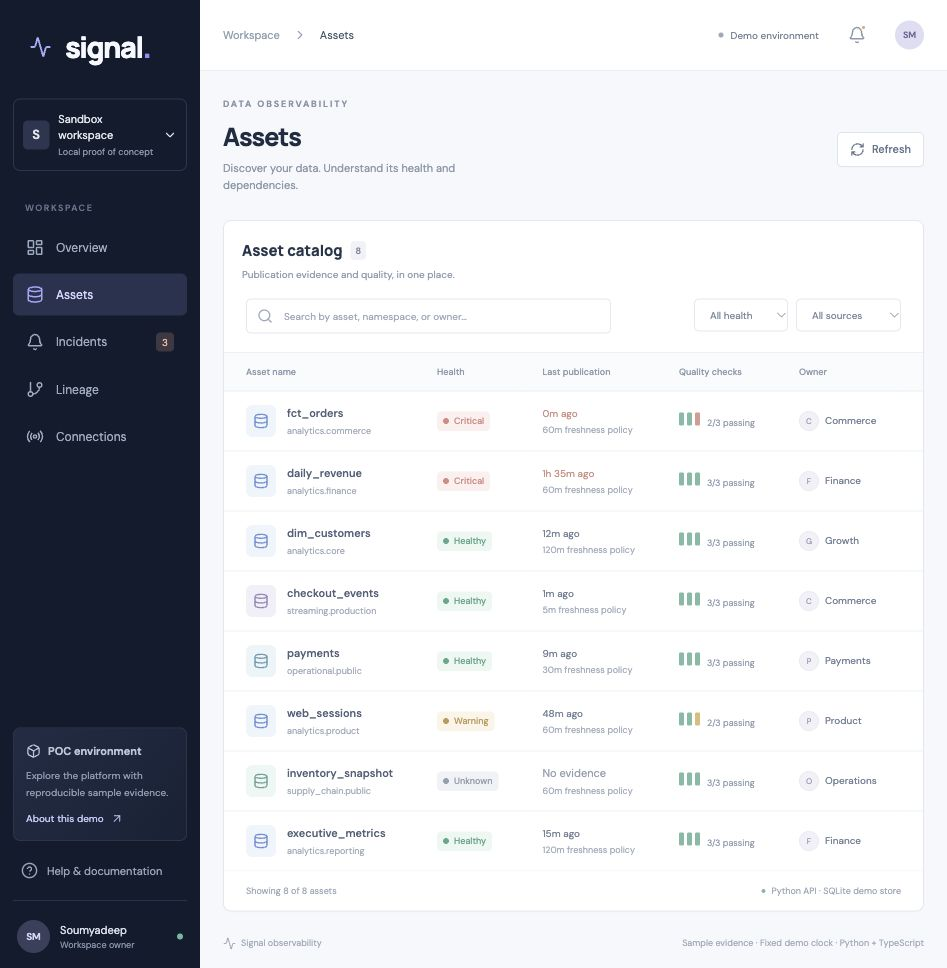
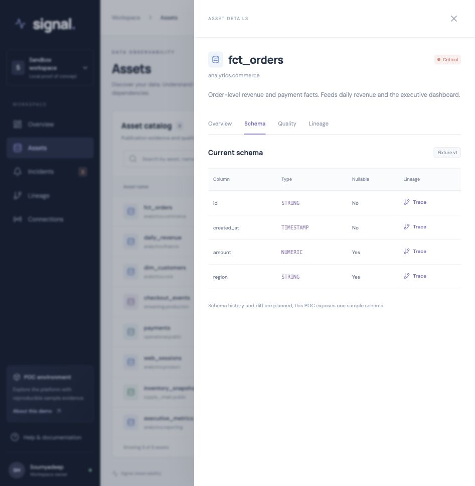
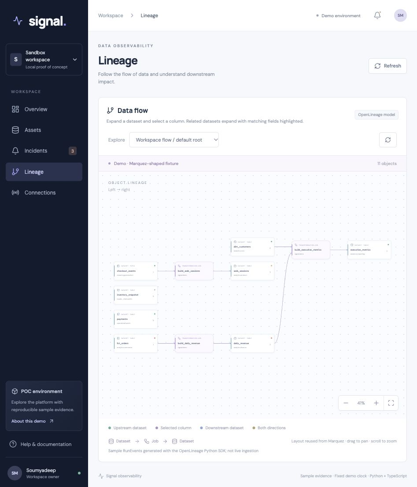
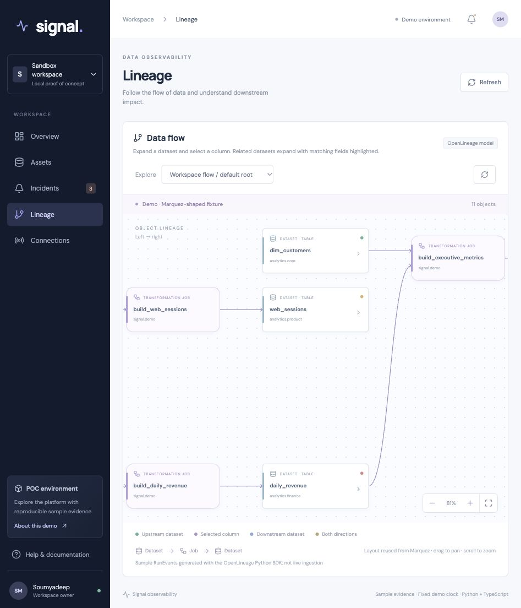
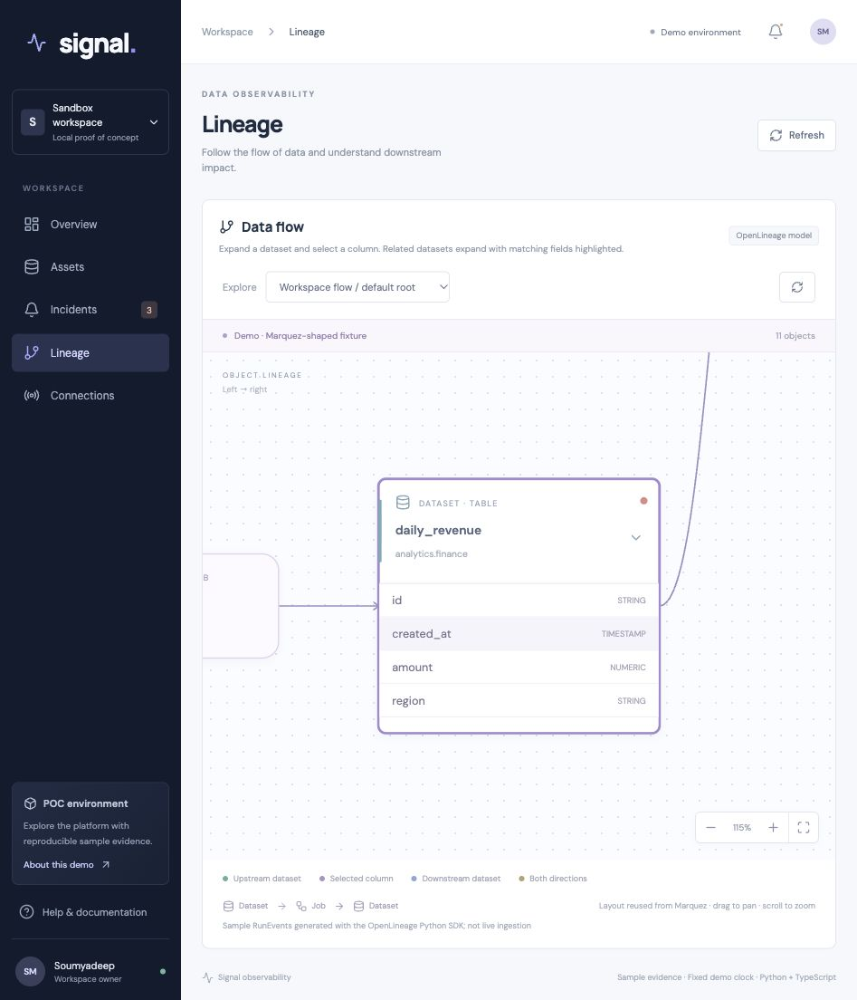
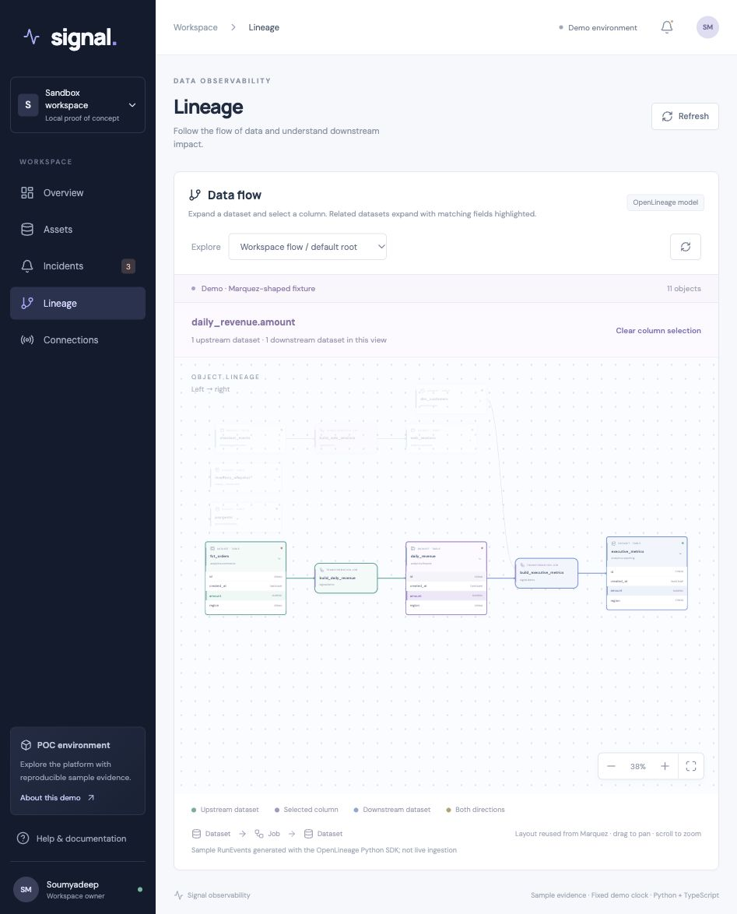

# Observability platform · v1.0.0

A local data observability POC with a **Python FastAPI backend** and a **React + TypeScript UI**. The original architecture and security proposals remain below.

## Run the POC

Requirements: Python 3.9+ (3.12 recommended), Node.js 22.14+ and npm. Run from the repository root.

```sh
python3 -m venv .venv
.venv/bin/python -m pip install -r backend/requirements-dev.txt
cd frontend
npm ci --legacy-peer-deps
cd ..
python3 scripts/frontend.py build
python3 scripts/serve.py
```

Open **http://127.0.0.1:8000**. The same Python process serves both the compiled UI and `/api/v1`. Interactive OpenAPI documentation: **http://127.0.0.1:8000/docs**. Stop with Ctrl+C.

This checkout includes an ignored portable Node runtime in `.tools/node` and an installed `.venv`, so it is already prepared locally. On this machine, launch with `python3 scripts/serve.py`. On another machine, follow the setup commands above; `.tools` and `.venv` are not committed.

The frontend helper uses a temporary build workspace on macOS when the repository is under Documents. This avoids an observed esbuild stall while enumerating ancestor directories there. It copies sources and installed dependencies, runs the requested command, copies successful build output back to `frontend/dist`, and cleans up. The repository remains the source of truth. A bundled Node runtime is used if present, otherwise Node must be on PATH.

For ordinary frontend development outside that macOS Documents case, run the Python API and `npm run dev` in `frontend/`. Vite proxies `/api` to Python on port 8000. The development UI is served on the URL Vite prints.

## What works

- Health overview, asset search, combined source/health filters, and empty states.
- Asset drawer with current schema, quality results, publication evidence, and a connected lineage flow.
- Visual dataset → job → dataset graph with inline dataset expansion, schema rows, and column-driven upstream/downstream dataset highlighting. Reuses Marquez layout, with pan/zoom and an optional live Marquez API adapter. See [lineage integration](docs/lineage.md).
- Incident acknowledgment and resolution with validated state transitions.
- Sample sink publication: UI → FastAPI → SQLite → recomputed health.
- Durable publication deduplication, conflicting event detection, and protection against out-of-order evidence regressing current state.
- Append-only mutation history (until demo reset), exposed at `GET /api/v1/history`.
- Connector capability cards showing unsupported and unconfigured capabilities explicitly.
- Demo reset from **About this demo**, restoring the original fixtures.

## UI screenshots

Screenshots of the running local application, including the navigation and page context. The data shown is reproducible demo evidence.

### Overview

Health summaries, asset health distribution, active incidents, and the monitored asset table:



### Asset catalog

Dataset inventory with source and health filters, freshness, quality checks, and ownership:



### Dataset schema

The asset drawer keeps the catalog in context while showing field types, nullability, and trace actions:



### Lineage overview

The graph page shows datasets and transformation jobs with curved connectors and pan/zoom controls:



Connector detail at a readable zoom, with continuous curves and small open arrowheads:



### Expanded dataset

Clicking a dataset reveals its schema directly in the graph:



### Column tracing

Selecting `daily_revenue.amount` automatically expands related datasets and highlights upstream and downstream fields. There is no standalone Columns tab:



## POC boundaries

The catalog's eight assets, schemas, quality results and connectors are fixtures. Lineage defaults to SDK-generated demo fixtures; optionally configure a real Marquez service as described in [lineage integration](docs/lineage.md). The clock is fixed at **2026-11-01 12:00 UTC** for reproducible freshness demonstrations. Metric sparklines are decorative samples, not historical observations. Column health and alerts use the existing sample check results and explicitly scoped incidents. Missing checks or unavailable collection yield unknown health; table freshness and unscoped alerts are not inherited by columns. Alert rule configuration, live column health ingestion, schema version history, live source collection, source credentials, connector workers, PostgreSQL queues, full OpenLineage/MCP compatibility, authentication, tenant isolation, and production deployment are not implemented. The loopback-only server is intended for local use.

The backend owns health and mutation rules. `FAIL` is an assertion failure; `ERROR` is a monitor execution problem; unavailable collection yields unknown health. A publication changes freshness, not quality. Resolving an incident records triage and does not rewrite asset evidence or auto-clear other incidents. Publication ingestion is synchronous and returns **200 only after SQLite commits**; it does not claim the architecture's asynchronous 202/inbox semantics.

SQLite uses atomic transactions and a write lock for mutation/read-modify-write operations. Default file: `backend/demo.sqlite3` (ignored). Override with `OBSERVABILITY_DB=/absolute/path/demo.sqlite3`. The demo reset clears both mutation history and publication deduplication records.

The TypeScript interfaces currently mirror the API response contract manually. Generating client types from OpenAPI is a next step before broadening the API.

## Tests and build

```sh
cd backend
../.venv/bin/python -m pytest -q
cd ..
python3 scripts/frontend.py check
```

Backend: 44 tests covering health boundaries, unknown monitors, ERROR versus FAIL, API filtering, validation/rollback, duplicates/conflicts, equivalent timestamp offsets, out-of-order evidence, concurrent retries, restart persistence, incident transitions and reset, plus Marquez adapter requests/failures, RunEvent forwarding, dataset schema reads, column graph contracts, explicit multi-input mappings and empty coverage.

Frontend: 35 tests using Vitest and React Testing Library, covering filtering, drawer/schema navigation, focus restoration, incident updates, publication requests, API failures, coverage limitations and presentation helpers, and actual Marquez layout with graph edges, node selection and zoom, dataset schema inspection, and per-field lineage navigation, removal of Columns navigation, graph-focused schema trace links, smooth connector geometry, automatic schema expansion, persistent row highlights, directional impact, cycles, co-input isolation and asynchronous selection races. `check` also runs strict TypeScript checking and the production build. GitHub Actions runs the backend tests and frontend checks on pushes and pull requests.

Browser verification: combined Python-served UI, publication mutation and persistence after reload, demo reset, plus responsive layout checks. Live Marquez service verification is pending: Docker is not installed on this machine; adapter tests use a mock HTTP transport. Tests use fixtures and temporary databases and do not connect to external systems.

## Repository layout

```text
backend/app/           FastAPI routes, domain health rules, sample fixtures
backend/tests/         pytest API and persistence tests
frontend/src/          React/TypeScript UI, API client and component tests
scripts/               Local build/check, fixture and diagram generators
docs/                  Integration notes, design proposals and UI previews
deploy/                Optional Marquez services
.github/workflows/     CI checks
```

## Architecture proposals

The root contains only this README, the project license, and application/support folders. Historical proposals are preserved under `docs/design/`, with editable sources and exports in `docs/design/diagrams/`. Generated output stays with its sources; no design or license content was discarded.

The POC intentionally implements a small local slice of these proposed release designs. The current UI choice is TypeScript per the implementation request; Python remains the backend language.

- [Detailed architecture design](docs/design/data_observability_design.md)
- [Cloud-native security design](docs/design/security_design.md)
- [Architecture diagram (SVG)](docs/design/diagrams/architecture.svg)
- [Release 1 design](docs/design/release1_design.md)
- [Editable diagrams.net file](docs/design/diagrams/release1_architecture.drawio)
- [Offline architecture viewer](docs/design/diagrams/release1_viewer.html)
- [Release 1 logical architecture](docs/design/diagrams/release1_architecture.svg)
- [Availability and recovery](docs/design/diagrams/release1_availability.svg)

Regenerate diagrams with `python3 scripts/build_diagrams.py` (Python standard library only).
