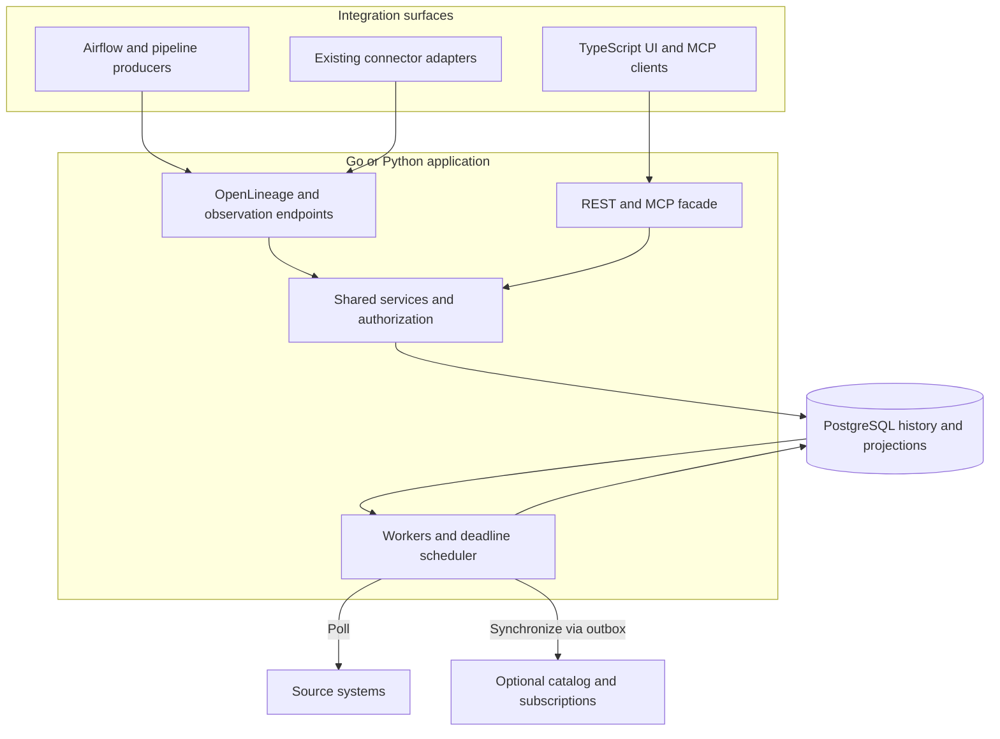
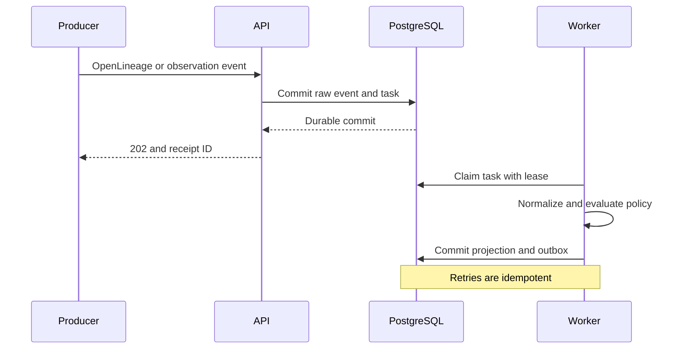

# Data observability platform architecture

28 October 2026 | Version 1.1

## Architecture overview

The application exposes native protocols and routes them through shared authorization and domain services. PostgreSQL owns both durable observations and historical state. Background workers evaluate deadlines even when no events arrive. Catalog synchronization is optional and asynchronous.

The editable Mermaid diagram below is self-contained. The companion `architecture.svg` and `architecture.png` provide a presentation-ready view when downloaded beside this document.



### Diagram reading guide

- The backend boundary is a logical boundary, not a requirement to deploy each box as a microservice.
- Ingestion commits an observation and work item atomically before acknowledging acceptance.
- Workers persist projections and outbox entries atomically; external delivery happens afterward.
- Queries read authorized projections; read paths are omitted from the presentation diagram to keep it legible.
- Connector adapters and external MCP connections have explicit capability mappings. Neither is assumed to be universally interchangeable.

### Durable ingestion sequence



## Design decision and scope

Build an open source data observability application with a modular backend, a TypeScript frontend and PostgreSQL for durable state. Prefer Go for the custom application when deployment simplicity matters most. A Python implementation is equally valid when extending existing ingestion and quality libraries is the main workload. Implement one backend variant first; the public contracts remain identical.

The platform inventories assets and columns, displays upstream and downstream dependencies, tracks execution and publication, evaluates freshness, presents dataset and column quality results, versions schemas and lineage, and reconstructs historical state for a configurable window of at least 30 days. Airflow, external connectors, scripts and MCP clients use the same authorized application services.

This document is a proposed implementation blueprint, version 1.0, dated 28 October 2026, prepared for Soumyadeep Mukhopadhyay. It distinguishes existing standards from project-defined extensions. Example endpoints, YAML, SQL and tool names are proposals, not existing product contracts. This is a design rather than a tested implementation or capacity guarantee.

Recommendation: own the observation history and health evaluation; reuse OpenMetadata for catalog ingestion and optionally its existing browsing UI. In the custom TypeScript frontend, present a unified view through a backend facade. OpenMetadata is replaceable through an adapter. Its deployment and search/database requirements remain additional infrastructure and must be included in operational planning.

MVP scope is batch tables, partitions, views, jobs and columns. Topics, files, dashboards and streaming assets can share the identity model but need type-specific health policies. Underlying dataset contents are not retained by this platform. Metadata retention and data retention are separate concerns.

## Requirements and acceptance criteria

Asset discovery must register tables that have never emitted a build event. An asset page must expose owner, source, schema, health dimensions, last successful publication, latest attempt, monitoring coverage and an observation timeline. Both table and column graphs support upstream and downstream traversal with depth and node limits.

Push and pull must normalize into the same observation model. A successful job, successful publication, recent watermark and passing quality suite are separate facts. A collector outage must produce unknown monitoring coverage rather than a fabricated failed build. Missing events must still cause a scheduled freshness deadline to be evaluated.

Acceptance scenario: a daily asset is due at 09:00 Asia/Tokyo with 15 minutes grace. Yesterday’s successful publication remains visible after today’s attempt fails. At 09:16, the freshness policy reports a missed deadline. When a delayed publication for today arrives, the platform records its true event time and receipt time, updates the appropriate partition and preserves the earlier failure.

History acceptance: for any instant within the retained window, an authorized user can retrieve the schema, policy, lineage and health effective then. A second mode answers what the platform knew at that instant. Duplicate events do not create duplicate executions. An old backfill never replaces today’s watermark. A DQ execution error is distinct from a failed assertion.

Integration acceptance: an Airflow DAG emits standard OpenLineage events without a custom provider dependency on the platform. A plain HTTP client can register metadata and submit results. A connector implemented in another language passes published conformance fixtures. An MCP client can discover tools and retrieve an authorized asset graph. Unsupported facets and partial lineage are visible, not silently treated as complete.

## Standards and interoperability boundaries

Use OpenAPI 3.1 with JSON Schema for the application HTTP contract initially because generator support must be verified before adopting a newer specification revision. Publish the specification, examples, error models and compatibility policy in the repository. REST clients need no SDK. A domain-specific asset API is still necessary: a standard API description does not standardize asset semantics. [S1]

Accept native OpenLineage events at a dedicated compatible endpoint, preserving their wire format. OpenLineage models jobs, runs and datasets and supports schema, lineage and quality facets. Choose and test supported specification and facet versions. Preserve unknown facets as opaque JSON with size limits. Transport acceptance and semantic support must be reported separately. [S2]

Use CloudEvents 1.0 for project-specific observations and outbound subscriptions. It standardizes event envelopes, not freshness or quality semantics. Do not require a CloudEvents wrapper on the native OpenLineage endpoint. JSON Schema versions define extension payloads. AsyncAPI may document subscriptions when those are introduced; it is not needed for initial synchronous requests. [S3]

Use MCP for agent discovery and tool invocation. Expose Streamable HTTP remotely and optionally a local stdio launcher. MCP supplies a common interaction protocol; it does not define a universal metadata schema or make arbitrary external tools interchangeable. An integration still needs capability and semantic mapping. [S4, S5]

JDBC, ODBC, database information schemas, dbt artifacts and existing connector frameworks are additional integration surfaces. Airbyte describes replication streams, records and state; its protocol can help discovery, but a replication connector does not inherently supply lineage, execution failure evidence or DQ results. A universal off-the-shelf observability connector protocol is not assumed. [S7]

## Component architecture and ownership

Organize the codebase into identity, observations, executions, metadata versions, lineage, quality, policies, evaluation, connectors, catalog synchronization, subscriptions and access control. Transport handlers call application services; services enforce invariants and use repository interfaces. The MCP layer calls the same services as HTTP rather than bypassing authorization through direct database access.

The API validates identity, authorization, quotas and envelope structure, then durably records an accepted event and processing task in one PostgreSQL transaction. A worker normalizes it, updates projections and writes outbound notifications to a transactional outbox. A scheduler enqueues polling and deadline evaluations. The frontend reads projections through the API.

PostgreSQL owns observations, execution history, health, policies, schema/lineage versions and job leases. If OpenMetadata is enabled, explicitly assign source ownership: source connectors own discovered schema; governance edits own descriptions and ownership; execution events own observed lineage. Synchronize by field and source, not by blindly replacing the whole entity.

For a lean start, one executable or Python package provides serve, worker, scheduler, migrate and mcp-stdio commands. API and background loops may share a deployment initially, with bounded resources and graceful shutdown. Connector execution can later move into isolated processes without changing contracts. Avoid Kafka, a graph database and Kubernetes until workload or operating requirements justify them.

Catalog writes are asynchronous and eventually consistent. Health/history queries do not depend on catalog availability. Each API response reports observation time, processing lag, catalog synchronization status and coverage. Use a consistent asset UUID across internal projections; keep catalog-specific identifiers in an external identifier mapping.

## Logical data model and identity

Asset: tenant_id, asset_id, asset_type, canonical_namespace, canonical_name, environment, platform_instance, lifecycle and owner reference. The platform assigns immutable UUIDs; namespace and name follow source naming conventions and are not lowercased blindly. Aliases map historical names and external URNs. Renames require explicit evidence so a drop and recreate is not merged accidentally.

Column: stable column_id, asset_id and schema-version membership, with nested field path, ordinal, type, nullable and description. Rename continuity is explicit where available and uncertain otherwise. A schema fingerprint excludes volatile descriptions. Preserve source type syntax alongside a normalized type representation.

Execution: job identity, logical execution key, run_id, attempt, parent run, nominal interval, actual times and terminal state. Publication: output asset, execution, partition, source version, commit time and watermark. Separate these records so partial output publication and retry attempts are represented correctly.

Observation: tenant, producer, event_id, source_event_id, kind, event_time, received_at, schema_version, payload reference, evidence quality and processing status. QualityDefinition: stable check ID, version, scope, executor and parameters. QualityResult: definition version, run, asset/column/partition target, metric, outcome and execution error.

LineageEdgeVersion: source and target asset/column IDs, relationship kind, provenance, confidence, valid_from and valid_to. PolicyVersion: schedule, timezone, freshness basis, grace, severity and effective range. HealthTransition: dimension, previous/new state, effective time, knowledge time and evidence references. ConnectorInstance tracks capabilities, cursor, lease, last successful observation and coverage.

## Event ingestion and processing semantics

Use at-least-once delivery and idempotent processing. Deduplicate by tenant, producer and source event ID. OpenLineage does not guarantee a universal envelope event ID, so derive a documented stable digest for exact replays and use source identifiers when provided. Correlate by job namespace, run UUID and event type without collapsing legitimate intermediate updates.

Return 202 only after durable acceptance. Include receipt_id and GET /v1/receipts/{id}; accepted does not mean all projections are updated. Synchronous resource mutations use ordinary 200/201 responses. Return structured errors for validation, scope failure, conflict, throttling and unsupported versions. A proposed Idempotency-Key header is bound to a payload digest; conflicting reuse returns 409.

Workers claim tasks with transactional leases and SKIP LOCKED, renew leases and acknowledge completion in the same transaction as projection writes. Lease expiry enables retry after crashes. Retry transient errors with capped exponential backoff and jitter. Permanent invalid payloads enter a bounded dead-letter store with an operator-visible reason and explicit replay action.

Store event time and receipt time independently. Preserve source ordering/version tokens where available. Run state transitions cannot regress from terminal to running merely because START arrived late. Contradictory terminal evidence remains visible and follows a source-specific precedence rule. A successful publication is keyed to the asset partition and version, independent of processing arrival order.

Handle push/pull overlap by source execution identity when possible. When correlation is uncertain, retain both observations and mark the relationship uncertain. Do not infer success from absence of failure. Advance polling cursors only after the batch is committed; overlap polling windows to tolerate eventual consistency. Use a lookback window and deduplication rather than a fragile strict timestamp cutoff.

## Freshness and health evaluation

Policies support successful publication age, watermark lag, expected partition arrival and scheduled delivery. Start with explicit policies; anomaly detection is optional later. Publication age uses now minus last successful commit time. Watermark lag uses the policy’s required source interval minus the observed watermark, with source-clock confidence recorded.

For scheduled delivery, generate expected delivery instances keyed by asset, schedule and nominal interval. Resolve schedules in an IANA timezone, then store UTC deadlines. Define DST ambiguity and skipped-time behavior; record the schedule library version and resulting deadline. Distinguish late publication, missed delivery, running execution and missing monitoring coverage.

Health is a vector: execution, publication freshness, watermark freshness, quality, schema compatibility, upstream impact and monitor coverage. An optional overall badge is derived from documented policy and displays contributing reasons. Upstream failure adds an impact indicator; it does not prove the downstream dataset’s existing contents are invalid.

Example: today’s job fails at 08:55; yesterday’s published asset remains available. Before 09:15 grace expires the latest attempt is failed while scheduled freshness may still be within deadline. At expiry, delivery is missed. A successful backfill for an older partition at 09:20 does not satisfy today’s expected partition. This behavior is covered by deterministic time-controlled tests.

Evaluate on incoming observations, policy changes and scheduled deadlines. Retention deletion must not manufacture a new stale state by erasing the last known publication. Persist current evidence separately from expiring observations. Alert only on configured transitions, with deduplication, recovery messages, maintenance windows and cooldowns. Monitor collector lag so alerts distinguish missing data from missing evidence.

## Schema and column lineage design

Schema discovery can read system catalogs, table-format metadata, dbt artifacts or explicit producer submissions. Store complete schema versions with source provenance and fingerprints. Classify additions, removals, type changes, nested structure changes and nullable changes. Breaking-change classification depends on consumer contracts; a type change is not universally compatible or incompatible.

Collect lineage from runtime instrumentation, query history and parsing, dbt relationships and explicit mappings. SQL parsing requires dialect and schema context for wildcard expansion and ambiguity resolution. Preserve unresolved references and parsing errors. UDF internals, dynamic SQL and arbitrary code may remain opaque. Track extraction coverage per asset and producer.

Version edges and mapping expressions. Distinguish direct value dependencies from columns that influence filtering or joins, where the extractor supports that distinction. Distinguish declared lineage from observed run lineage. Each observed edge references the run and transformation version that produced it. A historical graph uses edges effective at the requested time.

Connector snapshots need an explicit scope and completeness marker before omitted edges can be retired. A partial scan or failed extraction never deletes prior lineage. Competing sources retain separate provenance, and authoritative-source rules determine the displayed projection. Stale edges remain visible as stale until a valid retirement observation arrives.

Initially query adjacency tables in PostgreSQL using bounded recursive queries. Index tenant and endpoint IDs. Apply authorization during traversal; avoid revealing restricted assets through names or counts. Return pagination/truncation metadata, evidence and confidence. Add specialized graph infrastructure only after representative graph benchmarks show PostgreSQL is insufficient.

## Data quality execution and result interoperability

Support externally executed tests first. Pipelines can submit results from dbt, Deequ, Great Expectations or custom SQL through adapters. The UI separates check definitions, individual executions, latest results and historical trends. Dataset, column, partition and multi-column checks have explicit targets; a multi-column check is not duplicated as independent column failures.

Normalize outcomes to PASS, FAIL, ERROR, SKIPPED and UNKNOWN while preserving native outcomes. FAIL means a valid check violated its threshold. ERROR means execution could not determine the result. Missing results become unknown or expired according to policy, rather than automatically passing. Store measured values, thresholds, units, row counts, sampling scope and executor version.

A check definition is immutable by version. Results reference the exact definition and schema version they evaluated. Multi-query checks record the snapshot or transaction context where available. An otherwise passing result from an older partition or schema does not certify the latest asset state.

Optional platform-executed checks run in isolated workers with read-only credentials, query timeouts, scan budgets and bounded concurrency per source. Compute near the data. In a Go backend, invoke Python/Spark executors through process or HTTP boundaries when an established library supplies the check. A Python backend can use those libraries directly, but distributed Spark execution remains a separate workload.

Store aggregates and evidence references by default. Failed-row samples are opt-in, capped, access controlled and retained under a separate shorter policy. Do not put credentials or sensitive row values in errors, outbound events or MCP responses. Publish adapter mapping fixtures so a custom result producer can prove equivalent semantics.

## Airflow integration

Preferred path: configure the Apache Airflow OpenLineage provider to emit to the platform’s compatible endpoint. The provider uses listeners and operator extractors to collect DAG/task metadata and run events. Coverage and minimum Airflow versions depend on the provider release; pin and test supported combinations rather than promising support for every operator. [S6]

Expose POST /api/v1/lineage for native OpenLineage HTTP transport compatibility, separate from project REST versioning. Integration setup includes endpoint, namespace and credentials in the provider/client configuration supported by the pinned release. Include a tested deployment example in the implementation repository; configuration syntax is intentionally not assumed stable here.

For custom operators, use OpenLineage extractor hooks where supported or submit an explicit publication observation after a committed output. For custom DQ results, use a normal HTTP hook/operator or a thin optional Python SDK. The SDK is convenience only. A platform-specific Airflow provider package is optional and should wrap public APIs without introducing a second protocol.

Map DAG runs to parent execution, tasks to child runs and retries to attempts. Capture mapped task identity and logical data interval. A successful task may only submit work to an external engine: require actual completion evidence or a follow-up poll before asserting publication. A failed task can have valid upstream or partial output evidence.

Fallback polling reads the deployment’s supported Airflow public API with a least-privilege account, overlapping cursor windows and rate limits. Do not read Airflow’s internal metadata database. If scheduler events and poll results disagree, retain provenance and compare source revision/timing. Include tests for task retries, skipped tasks, mapped tasks, reschedules, backfills, delayed callbacks and provider/network outages.

## Connector compatibility and extension model

Existing connectors cannot be loaded interchangeably merely because they are open source. Classify reuse into native wire compatibility, framework adapters and artifact imports. Native OpenLineage producers require no platform SDK. OpenMetadata/DataHub ingestion outputs require mappings or catalog API synchronization. dbt artifacts provide schema, tests and dependency evidence with artifact-version-specific handling.

An OpenMetadata adapter can reuse the Python ingestion framework and read resulting catalog entities through supported APIs. Avoid claiming every connector emits execution status or column lineage. DataHub integration similarly maps URNs, schema, lineage and assertions explicitly. Select one ingestion framework for the MVP rather than operating both catalogs.

Airbyte discovery may supply stream schema, and its state can describe replication progress, but state is not automatically a business watermark or verified publication. Do not run read operations that move row data solely to discover metadata. Audit licenses for each connector and pinned dependency: protocol openness, source visibility and OSI-approved software licensing are separate properties. [S7]

For new connectors publish an Apache-2.0 project extension contract using JSON Schema and NDJSON over subprocess stdin/stdout, with logs only on stderr. Operations: describe capabilities, validate configuration, discover, collect and acknowledge cursor. This is a project-defined open contract, not an existing industry standard. Existing frameworks remain supported through adapters rather than forced migration.

Run untrusted connectors out of process. Apply deadlines, output size limits, egress allowlists and secret references. Capability declarations cover schema, dataset lineage, column lineage, execution, publication, watermarks and DQ. Publish a compatibility matrix with framework/version, supported capabilities, known gaps and conformance date. Provide import and export paths so users can leave without losing metadata.

## HTTP API contract

All endpoints except the native protocol endpoint use /v1. Publish /openapi.json and JSON Schema references. Scope every request to an authenticated tenant; never trust tenant IDs from payloads alone. Use cursor pagination with stable sorting, RFC 3339 timestamps, UTC storage, explicit timezone policies and bounded graph queries.

Read APIs: GET /v1/assets with filters; GET /v1/assets/{id}; GET /v1/assets/{id}/schema; GET /v1/assets/{id}/lineage?direction=upstream&depth=2; GET /v1/assets/{id}/health; GET /v1/assets/{id}/history; GET /v1/assets/{id}/quality-results. Historical reads accept valid_at and optional known_at. Responses identify the selected policy and evidence versions.

Write APIs: PUT /v1/assets/{id} for authorized metadata updates; POST /v1/observations for CloudEvents; POST /api/v1/lineage for OpenLineage; POST /v1/check-definitions; PUT /v1/policies/{id}; POST /v1/connector-instances; POST /v1/check-runs; POST /v1/exports. Long-running operations return 202 plus receipt or job location. Jobs expose status and cancellation semantics.

Use ETag and If-Match for concurrent edits. Document 400 malformed input, 401 unauthenticated, 403 unauthorized, 404 absent or hidden, 409 conflicting identity/idempotency, 412 stale edit, 413 oversized body, 422 invalid semantics, 429 throttling and 503 temporary dependency unavailability. Return application/problem+json with safe details and a trace ID.

Generate Go, Python and TypeScript client types from the pinned OpenAPI contract. Maintain a conformance suite that sends the same fixtures to either backend. Document additive evolution, deprecation windows and breaking major versions. Keep a complete raw export format containing IDs, versions, provenance and relationships; a CSV export alone cannot preserve temporal graph semantics.

## MCP server and external MCP connections

The application acts as an MCP server for agents. Provide GET/POST /mcp following Streamable HTTP negotiation and transport behavior; optionally package a stdio command for local tools. Advertise supported protocol versions and capability lists through normal MCP initialization. Test specific clients; compatibility requires a shared version, authentication flow and usable tool schemas. [S4]

Read tools: search_assets, get_asset, get_schema, get_lineage, get_health, list_quality_results and get_asset_history. Each has bounded pagination, typed JSON input and structured output with evidence timestamps and coverage. Provide resources for asset summaries and policy definitions where useful. Resource URIs are identifiers governed by the MCP server, not unrestricted filesystem paths.

Write tools are optional: submit_observation, propose_policy_change and request_check_run. Separate proposals from committed changes. Enforce the same permissions and optimistic concurrency as REST. Mark tool behavior accurately; descriptive annotations do not replace authorization. Long-running checks return job IDs rather than holding a tool call indefinitely.

Use the MCP HTTP authorization specification with a conforming authorization server, token audience checks and scoped access. Validate Origin as required by the transport and protect local binding. Never pass user bearer tokens through to unrelated upstream servers. For stdio, provide credentials through the launch environment or secure local configuration. [S4, S5]

Acting as an MCP client to arbitrary external servers is a separate optional connector capability. Allow administrators to register trusted servers, discover tools and approve explicit mappings to normalized observations. An external tool’s description does not establish that its output is correct or complete. Prevent prompt injection from turning returned metadata into instructions, prohibit unrestricted tool chaining and audit every outbound invocation. Start with read-only external mappings.

## Historical state and retention

Retain current state independently of the observation expiry policy. Default history retention is 30 days, configurable at tenant and asset level. Policy changes state when they take effect. Increasing the period preserves future observations but cannot recover expired history. Underlying data snapshots are outside this retention guarantee.

Use valid time for when a fact applied at the source and system time for when the platform learned it. Schema, lineage, policy and health versions carry both intervals where historical correction is required. GET history with valid_at answers effective state under current knowledge; adding known_at reconstructs what the platform could have shown then.

Retain a boundary snapshot at the start of the window plus subsequent deltas, or retain all versions whose validity overlaps the window. Preserve check definitions, policies and evidence summaries referenced by retained results. Long-unchanged schemas and last successful publications remain available even if their original raw events expire.

Partition observation, quality-result and transition tables by received time for manageable ingestion and deletion. Event time remains indexed for historical queries. For strict per-asset expiry, delete eligible rows inside mixed-policy partitions; drop a whole partition only when every row is eligible. Retention-class partitions are an optional optimization after measurement.

Run garbage collection with a recorded cutoff, dry-run counts, dependency checks and bounded transactions. Archive only if explicitly configured; backup retention must be documented separately from live retention. Protect replay by keeping compact idempotency tombstones at least as long as the supported redelivery horizon. Reject or quarantine excessively old replays instead of silently resurrecting purged history.

## Database design and capacity planning

Core tables: assets, asset_aliases, columns, schema_versions, schema_memberships, jobs, executions, publications, observations, lineage_edge_versions, check_definitions, quality_results, policy_versions, health_current, health_transitions, connector_instances, connector_cursors, task_queue, outbox and audit_log. Include tenant_id in all keys, joins and access paths.

Use typed columns for commonly queried IDs, times, status and partition keys; JSONB stores source-specific extensions and preserved payloads. Index observations by tenant/asset/event time, executions by job/logical interval/attempt, publications by asset/partition/commit time and graph edges by each endpoint. Use unique constraints for deduplication and version identity.

Use transactions for event acceptance plus queue insertion and for projection updates plus outbox insertion. A worker lease is not an exactly-once guarantee; downstream writes remain idempotent. Use a unique key containing the partition column where PostgreSQL partitioned-table constraints require it, and maintain a separate deduplication table if global uniqueness spans partitions.

Illustrative sizing only: 10,000 assets with 24 builds per day generate 240,000 build events/day if one event per build. At 2 KB each this is about 480 MB/day or 14.4 GB for 30 days before indexes, WAL, replicas and backups. START plus terminal doubles that count. Ten DQ checks per build add 2.4 million results/day. Profile full payloads rather than assuming build counts dominate.

A proposed initial load-test target is 100 accepted events/second sustained, a 10x short burst, health visibility within 60 seconds and sub-second common asset reads on a specified test environment. These are planning targets, not guarantees. Measure graph size, payload size, check-result frequency, source query latency and replay throughput before selecting instance sizes or adding a broker.

## Implementation options in Go and Python

Go variant: use net/http with a small router only if useful, pgx for PostgreSQL, explicit SQL or sqlc for typed queries, migrations checked into the repository and context-based deadlines/cancellation. Use bounded goroutine worker pools. Keep domain structs separate from generated transport types. A single binary can serve compiled frontend assets and expose serve, worker and scheduler modes.

Python variant: use FastAPI with Pydantic, psycopg or SQLAlchemy, Alembic migrations and bounded async tasks for I/O polling. Use separate processes for CPU-intensive parsing or library isolation. A PostgreSQL-backed durable task queue can be implemented with the same lease semantics as the Go variant. Avoid adding Redis solely because a task framework defaults to it.

For either variant use an official compatible MCP SDK and the tested OpenLineage client or schema types. Pin versions and validate licensing and support at implementation time. The Go variant may run Python ingestion containers; the Python variant may call Spark executors. Keep language boundaries at versioned process/HTTP contracts, avoiding in-process foreign-function interfaces.

Frontend: React and TypeScript with generated API types. Views include asset search, asset details, schema diff, bounded lineage graph, quality checks, execution timeline, connector coverage and retention settings. A historical time selector applies to schema, graph and health consistently. Always show evidence time, monitor lag and partial results.

Repository layout: contracts, backend, frontend, adapters, migrations, conformance, deploy and docs. In backend, separate application services, domain rules and infrastructure adapters. Do not maintain Go and Python server implementations in parallel unless there is a funded interoperability requirement. Open contracts make a later rewrite possible without doubling the initial maintenance burden.

## Security and operational design

Authenticate human users through OIDC and integrations through scoped service identities. Authorize actions by tenant, asset scope and capability. Separate read_metadata, write_observations, manage_policies, run_checks and manage_connectors. Apply authorization to historical reads, graph traversal, exports, subscriptions and MCP, including names embedded in errors.

Keep source credentials in a secret store or external secret references; encrypt any stored secrets and restrict worker access. Source polling and DQ queries use least privilege. Do not execute user SQL in the API process. Isolate connector processes and verify allowed network destinations to reduce SSRF and credential exfiltration risks.

Instrument HTTP latency, accepted/rejected events, queue depth, oldest unprocessed age, processing retries, dead letters, missed deadlines, source polling lag and catalog synchronization lag. Export OpenTelemetry-compatible telemetry where practical. Readiness checks must distinguish unavailable database from a temporarily unavailable optional catalog.

Maintain PostgreSQL backups and test restore plus projection rebuild. Define RPO/RTO operationally; suggested starting objectives are RPO 15 minutes and RTO 4 hours, subject to infrastructure validation. Since raw events expire, a full rebuild depends on retained boundary state and current projections as well as the retained event window.

Outbound webhooks are optional, signed with timestamped HMAC and delivered through the outbox with bounded retries and delivery IDs. Protect destination registration against private-network probing. Use matching transition IDs for deduplication. Notification delivery failure never rolls back an accepted asset observation.

## Delivery plan and verification

Phase 1: finalize asset identity and contracts; build API acceptance, PostgreSQL history, worker leases and current-state projections. Add one SQL source, one Airflow DAG and external DQ result ingestion. Demonstrate deadline-based freshness and a historical asset page before adding broad integrations.

Phase 2: add native OpenLineage compatibility, schema and column lineage, OpenMetadata adapter, TypeScript graph/history views and MCP read tools. Publish capability matrices and a third-party connector example. Phase 3: add isolated check execution, subscriptions, additional source adapters and operational hardening.

Required correctness tests: duplicate and out-of-order events, conflicting retries, crash before/after cursor commit, expired leases, partial output publication, older backfill, source outage, late schema correction, policy edits, DST boundary, partition freshness, DQ ERROR versus FAIL, authorization during graph traversal and historical retention boundary reconstruction.

Required contract tests: pinned Airflow provider emits accepted events; raw HTTP callers work without an SDK; supported facets project correctly; unknown facets survive export; both Go/Python client types match contracts; MCP initialization, tool schema, pagination and auth negotiation work against selected clients. Use source fixture repositories and golden normalized observations.

Release gates: migrations succeed on representative data; backup restore and replay are exercised; retention preserves unchanged current state; no hidden source access is required for read APIs; connector and transitive licenses are audited; scan budgets and payload quotas are enforced; the system survives catalog outage and recovers pending synchronization. Scale only after workload measurements reveal the constrained component.

## Decisions and outstanding choices

Accepted design decisions: standard native OpenLineage input; OpenAPI-described REST; optional CloudEvents extensions; MCP as an access surface; PostgreSQL as history authority; modular application before microservices; connector capability declarations; language-independent adapter boundaries; configurable history with boundary preservation.

Use OpenMetadata when connector coverage and its existing UI materially reduce work. If the platform must be a minimal standalone install, implement the narrow asset/schema registry internally and keep OpenMetadata optional. Do not deploy both a full custom catalog and a mandatory catalog product without a clear ownership boundary.

Decide before coding: first warehouse/table format; initial Airflow and provider versions; asset count and event volume; tenant isolation requirements; watermark versus schedule freshness defaults; whether 30 days means event history only or bitemporal reconstruction; maximum failed-row sample retention; managed versus self-hosted deployment expectations.

The recommendation is Go for the custom backend if simplicity of deployment and concurrent collection lead the priorities. Choose Python for the whole backend if most work extends the ingestion ecosystem. Both designs use the same database schema, OpenLineage input, OpenAPI contract and MCP semantics. TypeScript remains the frontend language in either implementation.

Do not promise universal connector or MCP compatibility. Publish exactly which protocol versions, authentication modes, tool operations and metadata capabilities have been tested. The platform remains open by publishing contracts, preserving extensions, providing exports and accepting plain protocol clients without mandatory proprietary SDKs.

## References and evidence

Sources were checked on 28 October 2026. Protocol facts below are sourced; architecture choices, proposed APIs, capacity targets and delivery phases are recommendations. Pin stable versions when implementation begins. Links to latest documentation can evolve.

[S1] OpenAPI Initiative. OpenAPI Specification. https://spec.openapis.org/oas/latest.html . A language-neutral description of HTTP APIs. This design proposes OpenAPI 3.1 initially for tooling compatibility, rather than claiming it is the latest revision.

[S2] OpenLineage. Object Model and Facets. https://openlineage.io/docs/spec/object-model/ and https://openlineage.io/docs/spec/facets/ . Jobs, runs, datasets and extensible facets. Backend support for particular facets must be tested.

[S3] CNCF CloudEvents. https://cloudevents.io/ . Common event envelope and cross-language SDKs. Domain-specific observation payloads in this document remain project-defined.

[S4] Model Context Protocol. Transports specification 2025-11-25. https://modelcontextprotocol.io/specification/2025-11-25/basic/transports . Standard stdio and Streamable HTTP transports, JSON-RPC and HTTP origin handling.

[S5] Model Context Protocol. Authorization specification 2025-11-25. https://modelcontextprotocol.io/specification/2025-11-25/basic/authorization . HTTP authorization and token handling. Test version negotiation against target clients.

[S6] Apache Airflow. OpenLineage integration structure. https://airflow.apache.org/docs/apache-airflow-providers-openlineage/stable/guides/structure.html . Listener and extractor integration; release-specific Airflow requirements.

[S7] Airbyte. Airbyte Protocol. https://docs.airbyte.com/platform/understanding-airbyte/airbyte-protocol . Catalogs, streams, records and state for replication. This is not a universal observability metadata protocol.

[S8] OpenMetadata. Custom Connectors and Ingestion Deployment. https://docs.open-metadata.org/v1.12.x/connectors/custom-connectors and https://docs.open-metadata.org/v1.12.x/deployment/ingestion . Python-based ingestion extension and external execution options.

[S9] OpenMetadata. OpenLineage connector. https://docs.open-metadata.org/v1.12.x/connectors/pipeline/openlineage . Connector transports and coverage are version-specific. Native platform acceptance does not imply every catalog field is synchronized.


## Example contracts and processing flow

The following CloudEvent is an illustrative project extension. It reports committed publication evidence; it is not an OpenLineage event and does not replace native OpenLineage ingestion.

```json
{
  "specversion": "1.0",
  "id": "publication-879-attempt-2",
  "source": "urn:producer:airflow:prod",
  "type": "org.observability.asset.published.v1",
  "subject": "asset/uuid-orders",
  "time": "2026-10-28T00:03:00Z",
  "datacontenttype": "application/json",
  "data": {
    "asset_id": "uuid-orders",
    "run_id": "run-879",
    "attempt": 2,
    "partition": {
      "date": "2026-10-28"
    },
    "committed_at": "2026-10-28T00:03:00Z",
    "watermark": "2026-10-27T23:59:59Z",
    "source_version": "snapshot-429"
  }
}
```

Request: POST /v1/observations with Content-Type application/cloudevents+json and an integration credential. Response: 202 with receipt_id and a receipt status URL. The authenticated principal supplies tenant scope; the payload cannot impersonate another tenant.

Processing: commit raw event and queue task; normalize asset and publication identity; reject contradictory evidence; update the partition publication projection; evaluate applicable deadlines; persist health transitions and outbox messages atomically. Catalog synchronization retries independently.


## MCP and retention examples

Example MCP tool definition fragment. This uses MCP tool concepts, but the tool name and result semantics belong to this project.

```json
{
  "name": "get_asset_history",
  "description": "Retrieve authorized asset state history",
  "inputSchema": {
    "type": "object",
    "properties": {
      "asset_id": {
        "type": "string"
      },
      "valid_at": {
        "type": "string",
        "format": "date-time"
      },
      "known_at": {
        "type": "string",
        "format": "date-time"
      },
      "limit": {
        "type": "integer",
        "minimum": 1,
        "maximum": 100
      }
    },
    "required": [
      "asset_id"
    ],
    "additionalProperties": false
  }
}
```

Return structured content containing selected schema_version, policy_version, lineage snapshot references, health dimensions, evidence timestamps, coverage and next_cursor. Permission filtering applies before pagination. A resource hidden from the user remains hidden from their agent.

Retention example: history_days is 30 and a schema has been unchanged for 180 days. Keep that schema as current and as the boundary version for the 30-day window. A correction received today may change effective history for last week, but a known_at query before today still shows the earlier belief. Raw payload expiration preserves the minimal evidence needed to explain retained transitions.

Illustrative PostgreSQL lease claim: SELECT id FROM task_queue WHERE available_at <= now() AND status = pending ORDER BY available_at FOR UPDATE SKIP LOCKED LIMIT 100. In implementation, pending is a bound parameter, and claim plus lease update occurs in one short transaction. External network work occurs after commit.

## Related downloadable assets

- `architecture.svg` is the editable vector export.
- `architecture.png` is the high-resolution raster export.
- The Mermaid blocks above remain editable without the companion files.
